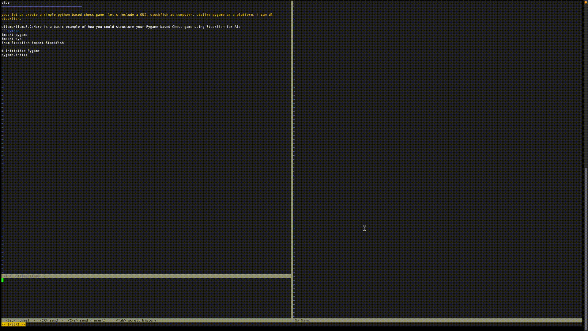

# kage.vim
## Overview
AI coding assistant for Vim and Neovim. Chat with your model about code and
perform inline edits — works in classic Vim 8.2 and Neovim, with local or
hosted models.

<p align="center">
	
</p>

- **Chat** Chat works end-to-end with Ollama, Anthropic, OpenAI, and any OpenAI-compatible endpoint.
- **ACP** ACP subprocess providers are supported. Inline
diff accept/reject UI is in progress.
- **Vim 8.2 and Neovim** — not Neovim-only
- **No npm.** One Go binary, one Vimscript file, nothing else to install
- **Local models first** — Ollama works out of the box, no config required
- **ACP mode** — front-ends any AI CLI tool (Claude Code, Codex CLI, custom scripts) as a backend directly, so you get the full agent loop without leaving Vim
- **Provider choice** — Anthropic, OpenAI, Cerebras, Groq, or bring your own via the `inherits` config key

## Requirements

- Vim 8.2+ or Neovim
- Go 1.22+ (to build the binary)
- A running provider — Ollama by default, no config needed

## Install

### 1. Build the binary

```sh
git clone https://github.com/vim-nvim-plugins/kage
cd kage
go build -o kage ./cmd/kage
mv kage ~/.local/bin/   # or anywhere on your PATH
```

### 2. Install the plugin

With [vim-plug](https://github.com/junegunn/vim-plug):

```vim
Plug 'vim-nvim-plugins/kage'
```

Or manually — copy `plugin/kage.vim` into `~/.vim/plugin/` (Vim) or
`~/.config/nvim/plugin/` (Neovim).

### 3. Configure a provider (optional)

Without a config file, kage defaults to Ollama at `localhost:11434`. To use
other providers, create `~/.config/kage/config.toml`. See
[Provider setup](#provider-setup) below.

## Usage

| Command | Description |
|---|---|
| `:Kage [prompt]` | Open chat panel, optionally send an initial prompt |
| `:KageChat` | Toggle the chat panel |
| `:'<,'>KageEdit [prompt]` | Send a visual selection for inline edit |
| `:KageInline [prompt]` | Send the current line for inline edit |
| `:KageCancel` | Cancel the current stream |
| `:KageProvider <name>` | Switch provider for this session |
| `:KageAddFile <path>` | Pin a file into every subsequent request |
| `:KageStatus` | Show current provider, model, session, pinned files |
| `:KageDebug` | Show internal state |

### Chat panel keys

The panel is two panes: a scrollable history (top) and an input buffer (bottom).

**Input pane:**

| Key | Action |
|---|---|
| `<CR>` (normal mode) | Send |
| `<C-s>` (insert mode) | Send |
| `<Tab>` | Move focus to history |
| `<C-c>` | Cancel the current stream |
| `q` | Close the panel |

**History pane:**

| Key | Action |
|---|---|
| `<Tab>` | Move focus to input |
| `<C-c>` | Cancel the current stream |
| `q` | Close the panel |

## Smoke test

```sh
kage test-provider ollama
# → should print the model's response and token usage
```

---

## Provider setup

### Ollama (default — no config needed)

```sh
ollama pull llama3.2
```

```toml
# ~/.config/kage/config.toml  (optional — these are the defaults)
default_provider = "ollama"

[providers.ollama]
endpoint = "http://localhost:11434"
model    = "llama3.2"
```

### Anthropic

Set the `ANTHROPIC_API_KEY` environment variable, then:

```sh
:KageProvider anthropic
```

Or configure explicitly:

```toml
default_provider = "anthropic"

[providers.anthropic]
api_key_env = "ANTHROPIC_API_KEY"
model       = "claude-sonnet-4-6"
```

### OpenAI

```toml
[providers.openai]
api_key_env = "OPENAI_API_KEY"
model       = "gpt-4o"
```

### Custom OpenAI-compatible endpoint

The `inherits = "openai"` key routes through the OpenAI-compatible provider,
so any endpoint that speaks `/v1/chat/completions` works:

```toml
[providers.cerebras]
inherits    = "openai"
endpoint    = "https://api.cerebras.ai/v1"
api_key_env = "CEREBRAS_API_KEY"
model       = "llama3.1-8b"

[providers.groq]
inherits    = "openai"
endpoint    = "https://api.groq.com/openai"
api_key_env = "GROQ_API_KEY"
model       = "llama-3.3-70b-versatile"
```

### ACP — subprocess providers

`type = "acp"` launches a local command for each request. The binary sends a
single JSON line on stdin and reads NDJSON events from stdout. Any script in
any language can implement this:

```toml
[providers.myscript]
type    = "acp"
command = "python3 ~/scripts/my_provider.py"
env     = {MODEL = "custom-model", LOG = "1"}
```

**ACP wire protocol:**

Input (one JSON line on stdin):
```json
{"messages":[{"role":"user","content":"..."}],"system":"..."}
```

Output (one JSON object per line on stdout):
```json
{"type":"text","text":"..."}
{"type":"thinking","text":"..."}
{"type":"end","usage":{"input":100,"output":50}}
{"type":"error","message":"something went wrong"}
```

The subprocess inherits the parent environment; `env` keys override or add to it.

## Change Log

### v0.3.0 (Latest)<br>
Renamed from vibe.vim to kage.vim
- Repo: github.com/vim-nvim-plugins/kage (old vibe URLs redirect)
- Commands `:Vibe*` → `:Kage*`, options `g:vibe_*` → `g:kage_*`, `<Plug>Vibe*` → `<Plug>Kage*`, `:help kage`
- Binary `kage`, config `~/.config/kage/config.toml` (move `~/.config/vibe/` there)
- `kage --version` now reports the release version
- Fixed: the repo was missing `cmd/kage/main.go` (an over-broad `.gitignore`), so step 1 of Install could not build
- Fixed: the vim-plug line no longer sets `'rtp': 'plugin'`, which kept the plugin and `:help kage` from loading

### Previous Versions
<details>
<summary>Previous Changes</summary>

***v0.2.0***<br>
Provider update

Features
- `:VibeChat` opens a two-pane split; type in the bottom pane and send with `<CR>`
- Current buffer is automatically sent as context with every message
- `:'<,'>VibeEdit` and `:VibeAddFile` send selections and pinned files
- Streaming responses render chunk-by-chunk with thinking block support
- Session history is kept — the model sees the full conversation
- `:VibeProvider` switches providers mid-session
- **Ollama**, **Anthropic**, **OpenAI**, and **ACP subprocess** providers all work

***v0.1.0***<br>
- Initial commit
- Ollama local chat
</details>

## Roadmap
- [ ] **Inline diff UI** — accept/reject edit proposals in a proper diff view
- [ ] **Tool approval UX** — approve/reject/always-allow tool calls from agentic backends


## Contributing
If you share the belief that simplicity empowers creativity, feel free to contribute.

#### Contribution is welcome in the form of:
- Forking this repo
- Submitting a Pull Request
- Bug reports and feature requests

Please ensure your code follows the existing style.

#### Project layout
```
cmd/kage/           binary entry point + protocol loop
internal/protocol/  NDJSON message types (binary ↔ plugin)
internal/provider/  provider interface + Ollama, Anthropic, OpenAI, ACP
internal/session/   conversation state + streaming
internal/config/    config.toml loader
plugin/kage.vim     the entire Vim plugin (one file)
doc/kage.txt        :help kage
```

## Thank you for your attention.
This project started out of curiosity and a simple C text editor tutorial. If you hit any issues, feel free to open an issue on GitHub.
Pull requests, suggestions, or even thoughtful discussions are welcome.
